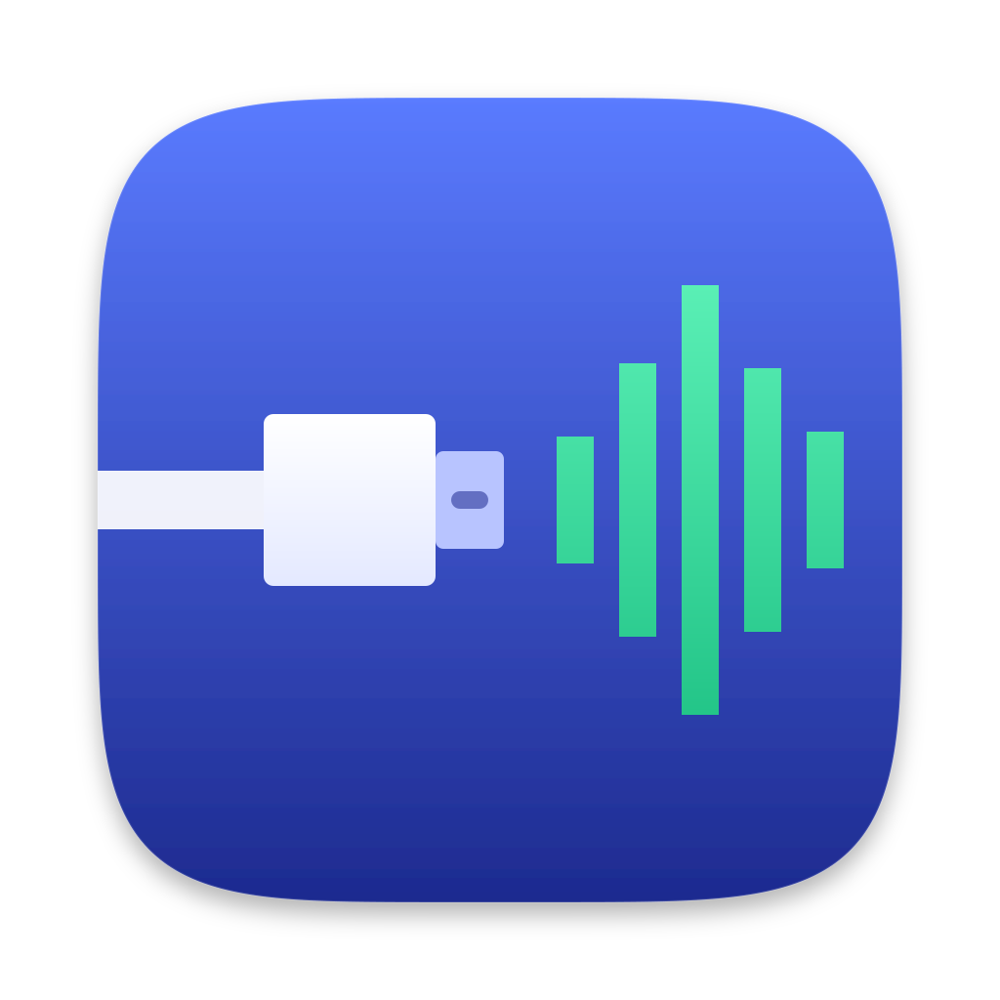

<p align="center">
  
</p>

# AudioPipe: play iPhone and iPad audio on your Mac over USB

**AudioPipe is a macOS menu bar app that plays the sound from iPhones and iPads plugged into your Mac by USB cable.** Connect one device or several. Each gets its own channel with volume, mute and solo, and AudioPipe mixes them live to your Mac's speakers, headphones or audio interface.

There's no AirPlay and no Wi-Fi involved, so there's no AirPlay delay, and nothing to install on the iPhone or iPad.

- [Features](#features)
- [Why USB instead of AirPlay?](#why-usb-instead-of-airplay)
- [Use cases](#use-cases)
- [Requirements](#requirements)
- [Install and build](#install-and-build)
- [Getting started](#getting-started)
- [FAQ](#faq)
- [Troubleshooting](#troubleshooting)
- [How it works](#how-it-works)
- [Privacy](#privacy)
- [Project status](#project-status)
- [For developers](#for-developers)

## Features

- **iPhone and iPad audio on Mac over USB.** Plug in a device and its sound plays on the Mac. No app needed on the device.
- **Several devices at once.** Every plugged-in iPhone or iPad gets its own channel in a live mixer.
- **Per-device volume, mute and solo**, plus a master volume, level meters and a peak limiter to stop clipping.
- **Low delay.** The audio comes over the cable, with a small buffer you can set anywhere from 0 to 200 ms (30 ms by default) instead of AirPlay's roughly 2 seconds.
- **Any output device.** Follow the system output or pin one: built-in speakers, wired or Bluetooth headphones, an audio interface, or a virtual device for recording and streaming.
- **Clock drift correction.** Each channel is kept in sync with the Mac's output clock, so the delay doesn't creep up over long sessions.
- **Menu bar app.** Quick controls in the menu bar, launch at login, and per-device volumes remembered between sessions.
- **No network access.** Everything stays on your Mac.

## Why USB instead of AirPlay?

You can already send audio to a Mac with AirPlay, but it's built for music and video, not for anything live:

| | AirPlay to Mac | AudioPipe over USB |
|---|---|---|
| Delay | Around 2 seconds for buffered audio | Mac adds a 30 ms buffer by default (adjustable 0–200 ms) plus your output device's latency |
| Several devices at once | The built-in AirPlay Receiver accepts one sender at a time | Yes, one channel per plugged-in device |
| Mixer | No | Volume, mute, solo, master, limiter |
| Connection | Wi-Fi, needs both on the same network | USB cable; no network needed |

## Use cases

- **Hear an iPad or iPhone through your Mac's speakers or headphones** while you work on the Mac.
- **Play iPad music apps through studio monitors or an audio interface** connected to the Mac, with much less delay than AirPlay.
- **Mix several iPhones and iPads into one output**: rehearsals, classrooms, game nights, or demoing an app on several devices at once.
- **App and game developers and testers**: listen to audio from test devices on your Mac without juggling headphones.
- **Record or stream iPhone and iPad audio**: pick a virtual audio device (for example BlackHole) as AudioPipe's output, then record or stream it in your DAW, OBS or QuickTime.

## Requirements

- A Mac running **macOS 14 Sonoma or later**.
- An **iPhone or iPad** and a USB cable (USB-C or Lightning, depending on the device).
- The device must be **unlocked and trusted** ("Trust This Computer") the first time you connect it.
- **Camera permission** for AudioPipe. macOS treats iPhones and iPads as camera devices, so it asks for this. AudioPipe only uses their sound and never records video. See [Privacy](#privacy).

## Install and build

### Download

1. Download the latest `AudioPipe-<version>.dmg` from [Releases](https://github.com/graphoarty/AudioPipe/releases/latest), open it, and drag **AudioPipe** to **Applications**.
2. Open AudioPipe and click **Allow** when macOS asks for camera access. AudioPipe is signed with a Developer ID and notarized by Apple, so it opens like any other downloaded app.

### Build from source

You'll need Xcode and [XcodeGen](https://github.com/yonaskolb/XcodeGen) (`brew install xcodegen`).

```bash
xcodegen generate
xcodebuild -project AudioPipe.xcodeproj -scheme AudioPipe -derivedDataPath build/DerivedData \
  CODE_SIGN_IDENTITY=- DEVELOPMENT_TEAM= build
open build/DerivedData/Build/Products/Debug/AudioPipe.app
```

The project signs with the maintainer's Apple Developer team. `CODE_SIGN_IDENTITY=- DEVELOPMENT_TEAM=` signs your build ad-hoc instead, so you don't need that team's certificates. To sign with your own team, set `DEVELOPMENT_TEAM` to your team ID.

To make a release disk image at `build/Release/AudioPipe-<version>.dmg`, set `MARKETING_VERSION` in `project.yml` and run the script below. It builds a universal Release app, signs the app and the DMG with the team's Developer ID, and has Apple notarize both, stapling the approval to each so they open even offline. The one-time setup (certificate and notarization credentials) is described at the top of the script.

```bash
Scripts/make-dmg.sh
```

## Getting started

1. Open AudioPipe. A short setup guide explains what it does.
2. When macOS asks whether AudioPipe may use the camera, click **Allow**.
3. Plug your iPhone or iPad into the Mac with a USB cable. Unlock it, and tap **Trust** if it asks.
4. The device appears in AudioPipe's menu bar panel. Play something on it and you'll hear it on the Mac.
5. Plug in more devices for more channels. Use the sliders and the **M** (mute) and **S** (solo) buttons to mix them.

To change the buffer, output device or limiter, open **Settings → Audio**. The Live table there shows each device's buffer, the delay the Mac adds, and clock drift.

## FAQ

### How do I play iPhone audio through my Mac speakers?

Plug the iPhone into your Mac with a USB cable, open AudioPipe and allow camera access when asked. The iPhone's sound then plays through whatever output the Mac uses, such as built-in speakers, headphones or an audio interface.

### Can I hear iPad sound on my Mac over a cable instead of AirPlay?

Yes. That's what AudioPipe does. Over USB there's no AirPlay buffer, so the delay is much lower than AirPlay's roughly 2 seconds.

### Can I mix audio from several iPhones and iPads on one Mac?

Yes, that's what AudioPipe is designed for. Each device plugged in by USB gets its own channel with volume, mute and solo, and AudioPipe mixes them together. So far it has only been tested with one device at a time; see [Project status](#project-status).

### Why does an audio app need camera access?

macOS presents a USB-connected iPhone or iPad as a camera-type capture device (audio and video together). Capturing even just its audio requires Camera permission. AudioPipe never reads the video stream and doesn't need microphone access.

### Why does my iPhone or iPad go silent when it's plugged in?

While AudioPipe captures it, iOS and iPadOS send the device's sound to the Mac instead of its own speakers. Unplug it, or turn AudioPipe off from the menu bar, and the device plays on its own speakers again.

### How much delay is there?

On the Mac side, the delay is the per-device buffer (30 ms by default, adjustable down to 0 ms) plus your output device's latency. Built-in speakers and wired headphones add a few milliseconds. Bluetooth headphones add much more (AirPods measured about 160 ms in testing), so use a wired output when delay matters. The device's own delay before sending isn't measured yet.

### Does it work over Wi-Fi?

No. AudioPipe only works over USB.

### Does AudioPipe record my screen or camera?

No. It doesn't capture video or your screen, and it makes no network connections.

## Troubleshooting

- **The device doesn't appear.** Unlock it and tap **Trust This Computer**. Try another cable or port; some cables only charge.
- **"Camera access is off".** Open **System Settings → Privacy & Security → Camera** and turn on AudioPipe. The Settings window has a button that takes you there.
- **Clicks or dropouts.** Raise the buffer in **Settings → Audio**. Audio arrives in blocks of about 21 ms, so below about 30 ms dropouts are likely; 40 ms played without any in testing.
- **Too much delay.** Use a wired output rather than Bluetooth headphones, and lower the buffer if there are no dropouts.
- **Audio stopped after sleep.** AudioPipe restarts capture when the Mac wakes. If it doesn't come back, right-click a channel and choose **Restart Capture**.
- **Logs.** Each device's capture log is in `~/Library/Logs/AudioPipe/device-<n>.log`, also viewable under **Settings → Diagnostics**.

## How it works

- macOS hides iPhones and iPads from capture APIs unless an app opts in with the CoreMediaIO property `kCMIOHardwarePropertyAllowScreenCaptureDevices`. This is the same public API QuickTime Player uses for iPhone recording. Each device then appears as a muxed (audio + video) `AVCaptureDevice` with the model ID `iOS Device`.
- AudioPipe captures only the audio, as 44.1 kHz stereo Float32 in blocks of about 21 ms, into a lock-free ring buffer per device.
- A drift controller nudges each channel's playback rate by at most 0.1 % to keep its buffer at the target depth against the output device's clock.
- The channels feed an `AVAudioEngine` mixer with a peak limiter on the master bus.
- Audio MIDI Setup's iOS "Enable" option (IDAM) would provide a plain Core Audio input instead, but turning it on requires a private Apple framework, so AudioPipe doesn't use it.

## Privacy

- **No network access.** AudioPipe has no networking code. Nothing leaves your Mac.
- **Camera permission is only for capturing device audio.** AudioPipe never reads video.
- **No microphone access** is needed or requested.
- **Stored locally:** your settings (in macOS preferences) and per-device capture logs (`~/Library/Logs/AudioPipe`).

## Project status

AudioPipe is an early release (0.1). It has been tested with an iPad and an iPhone, one at a time, on an Apple silicon Mac. Several devices at once are supported by design but not tested yet, and the Intel build hasn't been tried on an Intel Mac. Reports are welcome.

## For developers

| Path | What |
|---|---|
| `App/Core/WiredInput.swift` | Device discovery (CoreMediaIO opt-in) and audio capture per device |
| `App/Core/AppModel.swift` | Supervisor: devices, states, levels, drift control |
| `App/Core/AudioMixer.swift` | `AVAudioEngine` graph: per-device varispeed and mixer, limiter, output selection |
| `App/Views/` | Menu bar panel, Settings, onboarding, flat UI kit |
| `Packages/ReceiverKit/` | Per-device ring buffer, drift controller, levels, rotating logs. `CAudioCore` holds the real-time-safe ring buffer and render callback in C |
| `project.yml` | XcodeGen spec. It also generates `App/Info.plist` and `App/AudioPipe.entitlements`, so change those here |
| `Design/` | App icon source: `make_icon_svg.py` writes `AppIcon.svg` (64 px and up) and `AppIcon-small.svg` (bolder art for 16 and 32 px). `Scripts/make-app-icon.sh` renders them into `App/Resources/Assets.xcassets` (needs `brew install librsvg`) |

Unit tests (also run the ring-buffer stress test under Thread Sanitizer):

```bash
cd Packages/ReceiverKit && swift test && swift test --sanitize=thread
```

Notes:

- The device sends a backlog of about 100 ms when capture starts. The first 0.5 s is discarded so each channel starts at its buffer target.
- Buffer timestamps are assigned when audio reaches the Mac, so they can't show the device's own delay.
- macOS remembers Camera access by code signature. Team-signed builds keep it across rebuilds; ad-hoc builds change signature every time, so macOS asks again after each build.
- Launch flags: `--skip-onboarding`, `--show-settings`, `--preview-popover` (opens the panel's content in a window).
